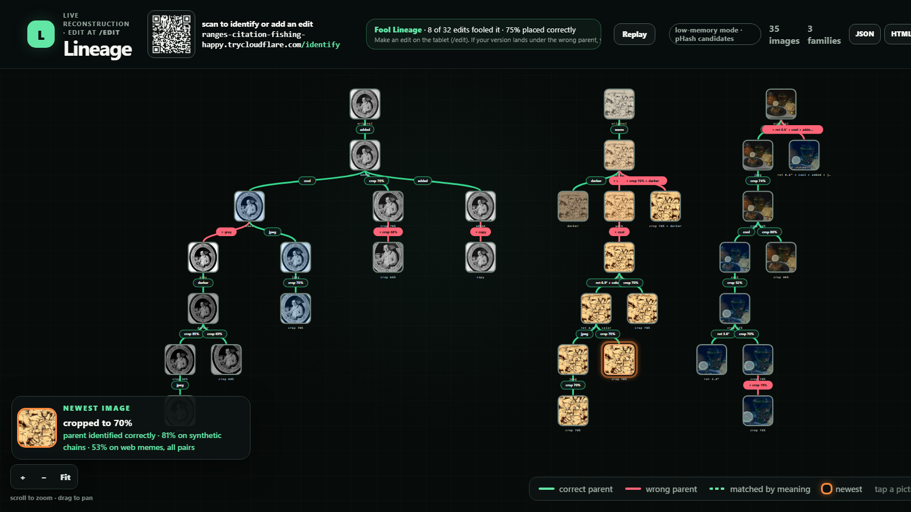
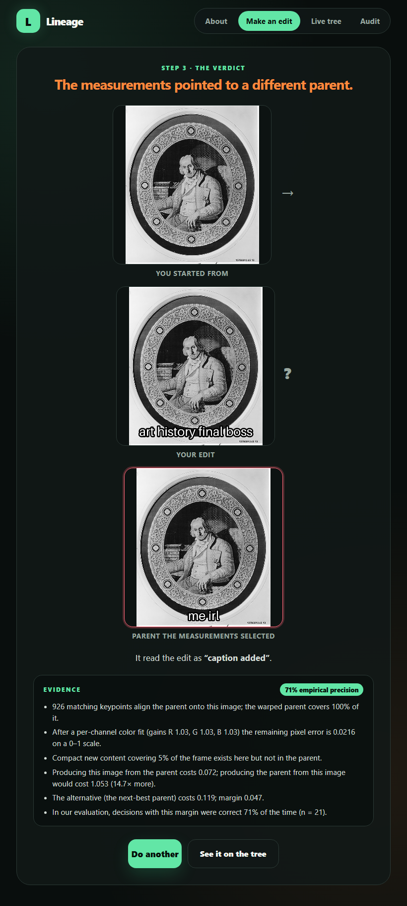
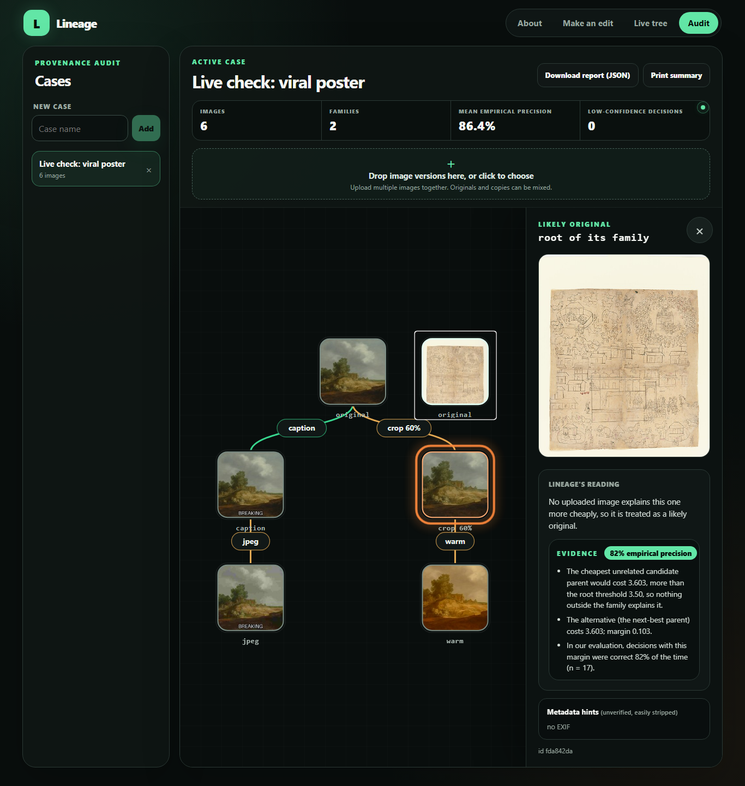
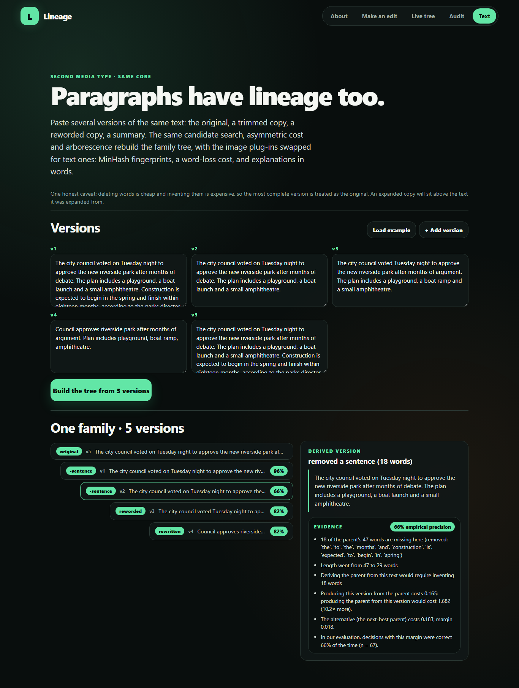

# Lineage

Given a pool of edited versions of an image, Lineage reconstructs the family tree: which
version is the original, who was derived from whom, and what edit produced each child. Every
decision comes with its measurements and an empirically calibrated confidence.

Core idea: edits destroy information. A child is cheaply explained as a lossy function of its
parent, but not the other way round. We score every candidate pair with an asymmetric
cost(a -> b), then take the minimum spanning arborescence of the directed graph.

Built at SwampHacks XII (University of Florida, Oct 16-18 2026).
Repository: https://github.com/JonathanKash/SwampHacks-Submission

## What you can do with it

| Page      | Who it is for | What happens |
|-----------|---------------|--------------|
| `/`       | everyone      | The idea, the pipeline, how to join the demo, the industry use cases |
| `/edit`   | tablet or phone | Pick a pool image, apply exactly one edit (crop, rotate, filter, caption, crunchy JPEG, AI restyle), submit, see the verdict with its evidence and the aligned evidence picture |
| `/tree`   | big screen    | The live forest: thumbnails, edge labels, a tree-accuracy scoreboard, an arrival overlay when a new image lands, a scan-to-join QR code, evidence and provenance panel |
| `/audit`  | industry      | Provenance audit: create a case (with analyst), drop in many versions, get the tree with calibrated precision and reliability tiers, visual diff plates, tamper-evident footprints (SHA-256, pHash), metadata and C2PA hints, compare any two images, JSON (hash-stamped, optionally HMAC-signed), CSV ledger and self-contained HTML reports |
| `/text`   | curious       | The same core on paragraphs: paste versions, see which was trimmed, reworded or rewritten |
| `/method` | judges        | Every cost term with its weight and direction logic, the arborescence, evidence and calibration, limitations |

Industry use cases: newsroom verification desks, trust and safety teams, legal discovery,
digital asset management. The engine is never told the true parent of anything; in the demo
the server keeps it only to score the accuracy counter.

| Big screen | Tablet verdict |
|---|---|
|  |  |

| Provenance audit | Text mode |
|---|---|
|  |  |

## Run it

```
py -3.13 -m venv .venv
.venv\Scripts\python -m pip install -r backend\requirements.txt
.venv\Scripts\python -m pip install torch --index-url https://download.pytorch.org/whl/cpu
copy .env.example .env                                            # add GEMINI_API_KEY for AI restyle

.venv\Scripts\python backend\scripts\fetch_seeds.py              # CC0 images from the Met
.venv\Scripts\python backend\scripts\seed_pool.py --reset        # pre-seed the demo pool with known chains
cd frontend && npm install && npm run build && cd ..              # builds frontend/dist
.venv\Scripts\python -m uvicorn app:app --app-dir backend --port 8010
```

Then open http://localhost:8010/. The first start downloads the CLIP weights (about 350 MB).
For frontend development run `npm run dev` inside `frontend/`; it proxies the API to port 8010.
`docs/DEMO.md` is the demo-day runbook and `deploy/README.md` covers the Vultr + Caddy deployment.

Evaluation and tests:

```
.venv\Scripts\python backend\scripts\gen_chains.py --name run1   # synthetic edit chains + truth
.venv\Scripts\python backend\scripts\eval.py data\synthetic\run1 # tree accuracy report
.venv\Scripts\python backend\scripts\calibrate.py data\synthetic\run1 data\synthetic\run2  # precision by margin
.venv\Scripts\python -m pytest backend\tests -q                  # 116 tests
```

## Compare two files: "Why is this the parent?"

`POST /api/compare` (two files, or two item ids from the pool or a case) returns a verdict of
`parent-child`, `siblings`, `unrelated` or `inconclusive`, the calibrated precision for the measured
margin, the benchmark accuracy for the detected edit type, a signal table (what each signal found,
which direction it points, its weight, and whether it is pixel evidence or a metadata hint), the
signals that conflicted or were unavailable, measured AI-edit indicators, a limitations section, and
reproducibility data (tool version, weights hash, SHA-256 of both inputs). Inconclusive is a
first-class answer: when the two directions are within the margin we do not trust, no parent is
claimed. The same report is available on the `/compare` page and from the CLI.

## Command line (works at scale, no server)

```
.venv\Scripts\python backend\lineage_cli.py compare A.jpg B.jpg [--json]
.venv\Scripts\python backend\lineage_cli.py tree FOLDER [--json --out report.json]
.venv\Scripts\python backend\lineage_cli.py place IMAGE --against FOLDER   # where does IMAGE land; recognises a late original
.venv\Scripts\python backend\lineage_cli.py batch-compare FOLDER --out pairs.csv
```

Add `--no-clip` on small machines. Benchmarks: `python benchmark/run_benchmark.py [--no-clip] [--corpus ...]`
reports per corpus and edit type the direction accuracy, how often a wrong parent was claimed, how
often the system abstained, family root recovery, a calibration check and the failure cases.

## Benchmark corpora (not redistributed)

- `benchmark/nanobanana/`: eight openly licensed photographs from Wikimedia Commons (see
  `sources/credits.json` for titles, authors and licenses) plus Met CC0 seeds, each edited by Gemini
  through the Antigravity CLI with six instructions (object add, object remove, background swap,
  watercolor restyle, subtle retouch, meme caption). Ground truth: the source is the parent.
  `make_corpus.py` regenerates it; the images themselves are git-ignored.
- `benchmark/memes/`: 30 meme families with a documented original/template and variants collected
  from the web by a download script; manifest and credits are tracked, images are not.
- `data/synthetic/run1-3`: edit chains from the Phase 0 generator (crop, rotate, caption, filter, JPEG).

`python benchmark/run_benchmark.py --no-clip` prints per corpus and edit type: direction accuracy, how
often a wrong parent was claimed, how often the system abstained, family root recovery, a calibration
check and every failure case.

## Architecture

```
pool of items
   |  fingerprint(item)          plug-in 1: pHash + binarized CLIP (images) / SimHash + MinHash (text)
   v
candidate search (top-k)        core: Hamming distance, never n^2 costs
   |
   v
cost(a -> b) on candidate pairs plug-in 2: asymmetric "how cheaply is b made from a"
   |  (cached per pair)
   v
minimum spanning arborescence   core: Chu-Liu/Edmonds with a virtual root (forest-capable)
   |
   v
evidence + explain(a -> b)      plug-in 3 + core: "cropped to 62%, warm filter", both-direction
                                costs, runner-up margin, calibrated empirical precision
```

The image cost registers A onto B with ORB keypoints and a RANSAC homography, then charges for
what B has that A cannot supply: uncovered area, unexplained color after a per-channel fit,
lost JPEG grid energy, gained resolution, chroma or entropy, and detail present in A but
erased in B. A small per-edit-operation charge (a minimum-description-length prior) keeps
chains in order, and when registration fails the edge falls back to CLIP similarity. All
weights live in `backend/lineage/config.py`.

Confidence is empirical: `scripts/calibrate.py` runs the pipeline over synthetic edit chains
with known truth and records how often decisions with a given cost margin were right. The
API attaches that precision to every edge. On the held-out synthetic runs the tree accuracy
is 71% and 81% (83% on the run used for tuning); roots are found 6/6 on every run.

See `CLAUDE.md` for the file layout, `SPEC.md` for the specification and `PLAN.md` for the
evaluation history including rejected experiments.

## Accessibility

Reviewed against WCAG 2.2 AA (see `docs/research/accessibility-review.md`): text and pill contrast
pass (dark text on green, orange and red pills; interactive borders at 3:1), every tree node is a
keyboard-operable button with a visible focus ring, opening a node moves focus to its details
panel and back, edges carry descriptive labels and do not rely on color alone (wrong-parent pills
are prefixed with ×, semantic ones with ≈), the live accuracy counter and newest-image callout are
ARIA live regions, the audit upload has a keyboard-reachable file input, and all animations
honor `prefers-reduced-motion`.

## AI disclosure

The code in this repository was written with AI coding agents under our direction during the
event. We designed the approach (asymmetric information-loss cost, candidate search, minimum
spanning arborescence, the plug-in architecture, the demo flow, the evidence and calibration
protocol and the industry audit mode), specified each component, reviewed the output, and drove
the tuning from the evaluation numbers. Specifically:

- Claude Code (Anthropic, Claude Fable 5.1): the backend (cost function, candidate search, the
  Chu-Liu/Edmonds arborescence, engine and media interface, evidence and calibration, API,
  scripts, tests), the landing page, the guided edit flow and evidence UI, the text page, the
  deployment assets and the docs.
- OpenAI Codex (via the Codex CLI): the explain plug-in (`plugins/image_explain.py` and its
  tests), the initial React frontend scaffold (API client, polling hook, D3 tree view, first
  versions of the edit and tree pages), the audit workspace page, the text media plug-in and
  the Devpost draft.
- Google Gemini (via the Antigravity CLI): research of the current Gemini image-editing API,
  research of JPEG compression statistics (tried and rejected, see PLAN.md) and a route sanity
  check of the running app. Visual QA was done with Playwright screenshots reviewed by Claude
  Code.

The Chu-Liu/Edmonds implementation in `backend/lineage/core/arborescence.py` is written from
scratch (not a library call) and is cross-checked against networkx in the tests. Seed images
are CC0 works from The Met.

## Credits
- [c2pa-python](https://github.com/contentauth/c2pa-python) (Content Authenticity Initiative) reads and validates Content Credentials manifests; test fixtures from c2pa-rs.

Libraries: NumPy, OpenCV (opencv-python-headless), Pillow, NetworkX, PyTorch, open_clip
(OpenCLIP, ViT-B/32 weights by OpenAI), requests, python-dotenv, pytest, Playwright (QA only).
APIs and data: The Metropolitan Museum of Art Open Access API (CC0 images; per-image credits
in `data/seeds/credits.json`), Google Gemini API (google-genai) for AI restyle.
Backend: FastAPI, Uvicorn, httpx, SQLite. Frontend: React, React Router, Vite, D3, TypeScript.
Deploy: Docker, Caddy, Vultr.
